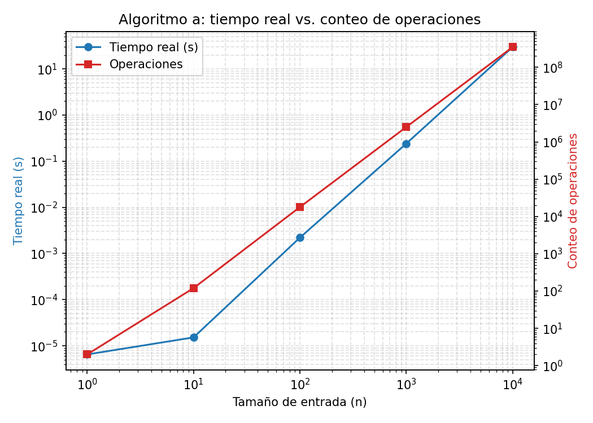
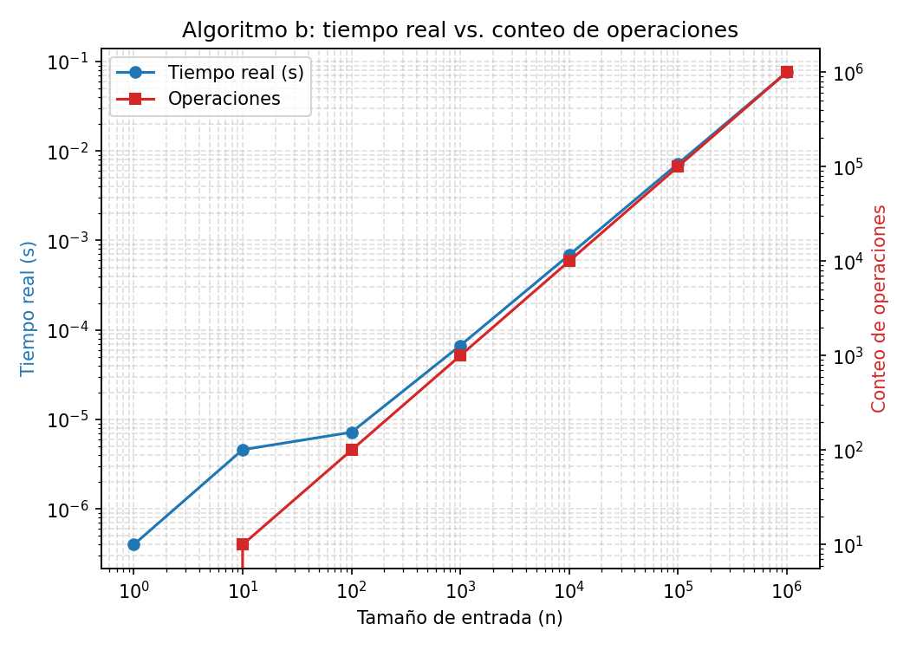
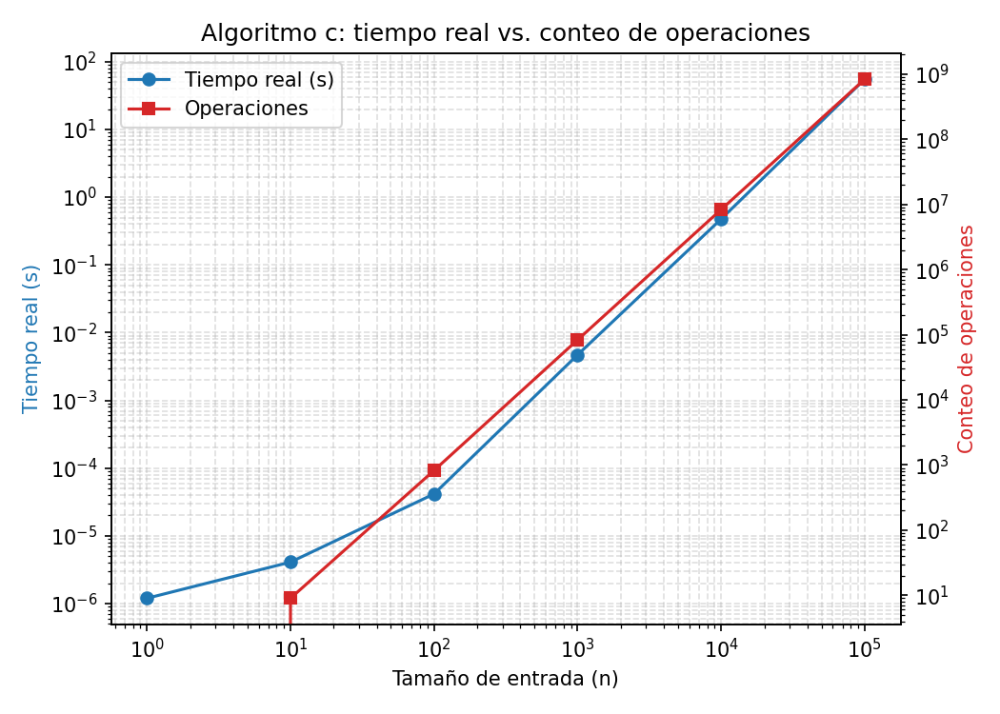

# Laboratorio 7 - Ejercicio 2

## Profiling de los tres algoritmos del ejercicio 1.

## Video

Video explicativo del laboratorio: [https://youtu.be/kp5kk3RlpMA](https://youtu.be/kp5kk3RlpMA)

## Instalación

```
pip install matplotlib
```

## Ejecución

```
python algoritmo_a.py
python algoritmo_b.py
python algoritmo_c.py
```

Cada comando imprime su tabla en la terminal y genera su propia gráfica (tiempo real y conteo de operaciones vs. n). Cada algoritmo revisa el tiempo transcurrido cada cierto número de operaciones; si supera el límite práctico (60s, configurable en `profiling_utils.py`), se detiene y ese tamaño y los mayores quedan marcados como N/A (timeout).

## Resultados

### Algoritmo a

| n | tiempo (s) | operaciones |
|---|---|---|
| 1 | 0.000005 | 2 |
| 10 | 0.000014 | 120 |
| 100 | 0.002136 | 17850 |
| 1000 | 0.332757 | 2505000 |
| 10000 | 27.239649 | 350070000 |
| 100000 | N/A (timeout) | N/A |
| 1000000 | N/A (timeout) | N/A |



Por su complejidad O(n²log n), a partir de n=100000 el tiempo excede el límite práctico de ejecución (60s). Es un resultado esperado, consistente con la clasificación big-Oh del ejercicio 1.

### Algoritmo b

| n | tiempo (s) | operaciones |
|---|---|---|
| 1 | 0.000002 | 0 |
| 10 | 0.000011 | 10 |
| 100 | 0.000025 | 100 |
| 1000 | 0.000062 | 1000 |
| 10000 | 0.000698 | 10000 |
| 100000 | 0.008218 | 100000 |
| 1000000 | 0.098660 | 1000000 |



Al ser O(n), corre completo y rápido en los 7 tamaños; el tiempo crece de forma lineal con n.

### Algoritmo c

| n | tiempo (s) | operaciones |
|---|---|---|
| 1 | 0.000002 | 0 |
| 10 | 0.000008 | 9 |
| 100 | 0.000076 | 825 |
| 1000 | 0.005134 | 83250 |
| 10000 | 0.508418 | 8332500 |
| 100000 | 54.038956 | 833325000 |
| 1000000 | N/A (timeout) | N/A |



Al ser O(n²), el tiempo crece cuadráticamente con n (al multiplicar n por 10, el tiempo crece aproximadamente 100 veces); en n=1000000 excede el límite práctico de ejecución.